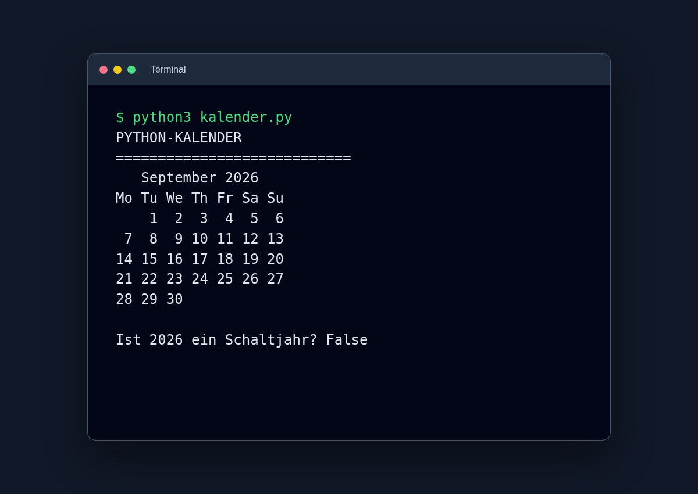

# Python-Kalender

## Dein Ziel

Erzeuge mit Python diese Kalenderansicht im Terminal:



## Arbeitsauftrag

1. Erstelle die Datei `kalender.py`.
2. Importiere das Modul `calendar`.
3. Gib die Überschrift, den September 2026 und die Schaltjahr-Information aus dem Screenshot aus.
4. Starte dein Programm mit `python3 kalender.py`.
5. Ergänze darunter einen zweiten Kalender für einen selbst gewählten Monat und ein selbst gewähltes Jahr. Gib dazu eine passende Überschrift und die Schaltjahr-Information für dieses Jahr aus.

Diese Funktionen helfen dir:

```python
calendar.month(jahr, monat)
calendar.isleap(jahr)
```

Setze für `jahr` und `monat` Zahlen direkt in die Aufrufe ein. Der Monat wird als Zahl von 1 bis 12 angegeben.

## Fertig, wenn

- dein Skript ohne Fehler läuft
- Kalender und Schaltjahr-Information sichtbar sind
- deine Ausgabe dem Screenshot erkennbar ähnelt
- darunter dein zweiter Kalender mit passender Überschrift und Schaltjahr-Information erscheint
