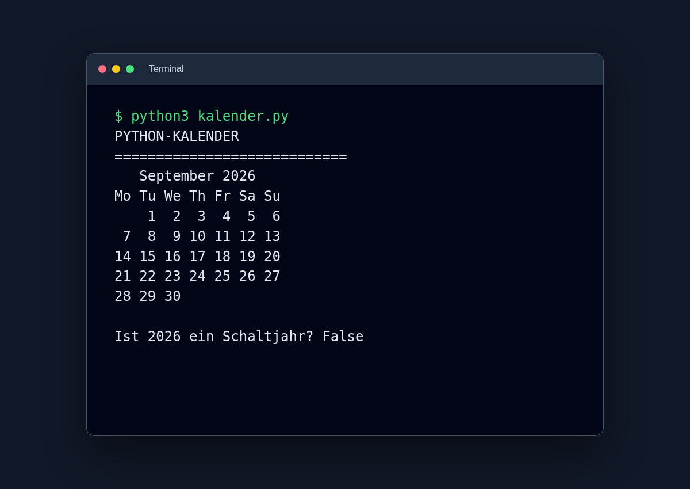

# Python Calendar

## Your goal

Use Python to create this calendar view in the terminal:



## Task

1. Create the file `kalender.py`.
2. Import the `calendar` module.
3. Print the heading, September 2026 and the leap-year information shown in the screenshot.
4. Run your program with `python3 kalender.py`.
5. Below it, add a second calendar for a month and year of your choice. Include a matching heading and the leap-year information for that year.

These functions will help you:

```python
calendar.month(year, month)
calendar.isleap(year)
```

Put numbers directly into the calls in place of `year` and `month`. The month is a number from 1 to 12.

## Done when

- your script runs without an error
- the calendar and leap-year information are visible
- your output recognisably matches the screenshot
- your second calendar appears below it with a matching heading and leap-year information
