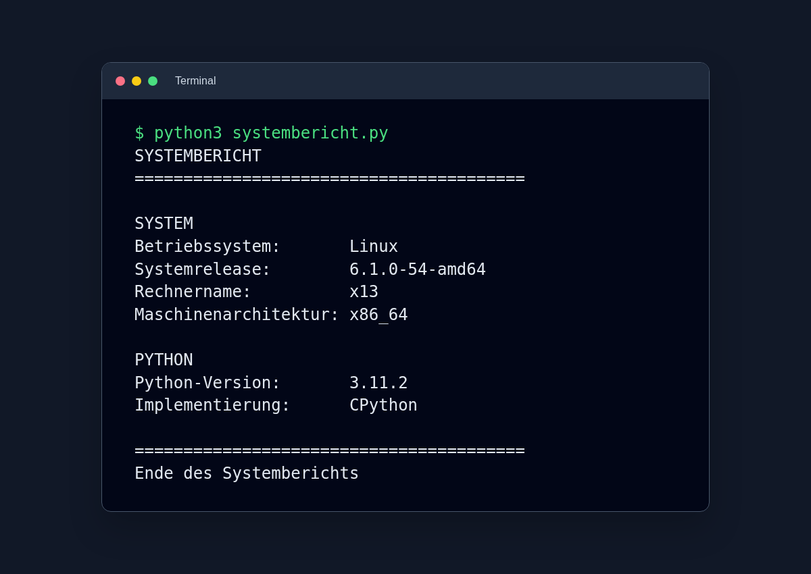

# Systembericht

## Dein Ziel

Erzeuge mit `print()` einen übersichtlichen Systembericht im Terminal:



## Arbeitsauftrag

1. Erstelle die Datei `systembericht.py` und importiere das Modul `platform`.
2. Gib die Überschrift, die Bereiche „System“ und „Python“ sowie die sechs beschrifteten Angaben aus dem Screenshot aus. Verwende echte Daten deines Rechners.
3. Gestalte die Ausgabe mit Trennlinien, Leerzeilen und Abständen so, dass sie dem Screenshot erkennbar ähnelt.
4. Starte dein Programm mit `python3 systembericht.py`.
5. Speichere dieselbe Ausgabe als Textdatei:

   ```bash
   python3 systembericht.py > systembericht.txt
   ```

6. Öffne `systembericht.txt` im Editor und prüfe, ob der vollständige Bericht gut lesbar ist.

`>` leitet die Ausgabe in eine Datei um. Bei diesem Aufruf erscheint der Bericht deshalb nicht im Terminal. Eine vorhandene `systembericht.txt` wird überschrieben.

## Diese Aufrufe helfen dir

| Aufruf | Information |
| --- | --- |
| `platform.system()` | Betriebssystem |
| `platform.release()` | Systemrelease, z. B. die Kernel-Version unter Linux |
| `platform.node()` | Rechnername |
| `platform.machine()` | Maschinenarchitektur, z. B. `x86_64` oder `arm64` |
| `platform.python_version()` | Python-Version |
| `platform.python_implementation()` | Python-Implementierung, z. B. `CPython` |

Die Werte auf deinem Rechner dürfen vom Screenshot abweichen. Falls eine Angabe leer bleibt, lass die Beschriftung stehen. Die Maschinenarchitektur ist nicht das genaue Prozessormodell.

Du kannst einer `print()`-Anweisung mehrere Angaben mit Kommas übergeben, zum Beispiel `print("Antwort:", 42)`.
