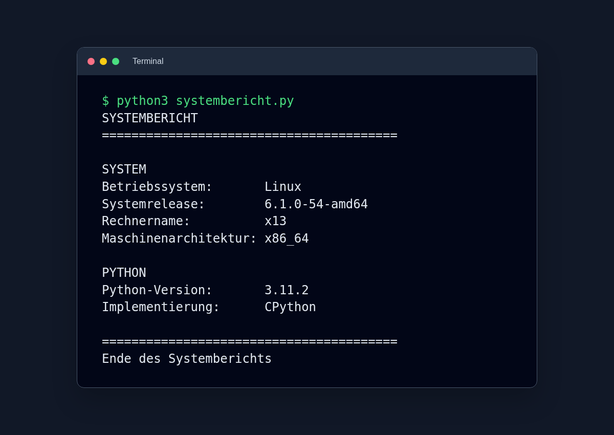

# System Report

## Your goal

Use `print()` to create a clearly structured system report in the terminal:



## Task

1. Create the file `systembericht.py` and import the `platform` module.
2. Print the heading, the “System” and “Python” sections, and the six labelled details shown in the screenshot. Use real data from your computer.
3. Use separators, blank lines and spacing so that your output recognisably matches the screenshot.
4. Run your program with `python3 systembericht.py`.
5. Save the same output as a text file:

   ```bash
   python3 systembericht.py > systembericht.txt
   ```

6. Open `systembericht.txt` in your editor and check that the complete report is easy to read.

`>` redirects the output into a file. The report therefore does not appear in the terminal when you use this command. An existing `systembericht.txt` is overwritten.

## These calls will help you

| Call | Information |
| --- | --- |
| `platform.system()` | Operating system |
| `platform.release()` | System release, e.g. the kernel version on Linux |
| `platform.node()` | Computer name |
| `platform.machine()` | Machine architecture, e.g. `x86_64` or `arm64` |
| `platform.python_version()` | Python version |
| `platform.python_implementation()` | Python implementation, e.g. `CPython` |

Your computer's values may differ from the screenshot. If a value is empty, keep its label. Machine architecture is not the exact processor model. The German labels in the shared screenshot may stay as they are.

You can pass multiple items to `print()`, separated by commas, for example `print("Answer:", 42)`.
