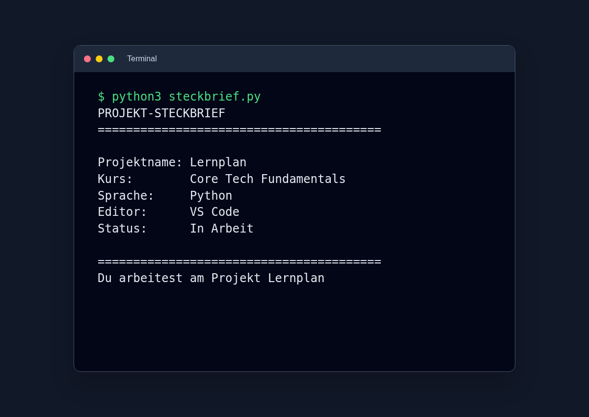

# Variablen

## Dein Ziel

Erzeuge diesen Projekt-Steckbrief. Speichere die fünf Projektangaben in Variablen und verwende diese in deiner Ausgabe:

## Arbeitsauftrag

1. Recherchiere, was eine Variable ist, wie du ihr einen Wert zuweist und wie du diesen mit `print()` ausgibst:
   - [W3Schools: Python Variables](https://www.w3schools.com/python/python_variables.asp): Lies „Variables“ und „Creating Variables“ bis einschließlich des ersten Beispiels mit `print(x)` und `print(y)`.
   - Wenn du lieber auf Deutsch liest: [Python-Kurs: Datentypen und Variablen](https://www.python-kurs.eu/python3_variablen.php#benutzung-von-variablen). Lies unter „Benutzung von Variablen“ nur den Anfang bis einschließlich der ersten `print()`-Ausgabe. Die Rechnungen danach brauchst du nicht.
2. Erstelle die Datei `steckbrief.py`. Definiere am Anfang fünf Variablen: für Projektname, Kurs, Programmiersprache, Editor und Status. Wähle passende Namen und verwende zunächst die Textwerte aus dem Screenshot.
3. Baue die Ausgabe mit `print()` nach. Gib Beschriftungen zusammen mit den Variablen aus. Verwende die Variable für den Projektnamen auch im letzten Satz, statt den Namen dort erneut als Text einzutragen.
4. Starte dein Programm mit `python3 steckbrief.py`.
5. Ändere den Projektnamen und den Status nur bei den Wertzuweisungen am Anfang. Führe das Skript erneut aus. Beide Stellen mit dem Projektnamen und die Statuszeile sollen die neuen Werte zeigen, ohne dass du die `print()`-Anweisungen änderst.

Du kannst Beschriftung und Wert mit einem Komma an `print()` übergeben. Verwende dafür deine Variablen. Eine schriftliche Zusammenfassung der Recherche ist nicht nötig.
