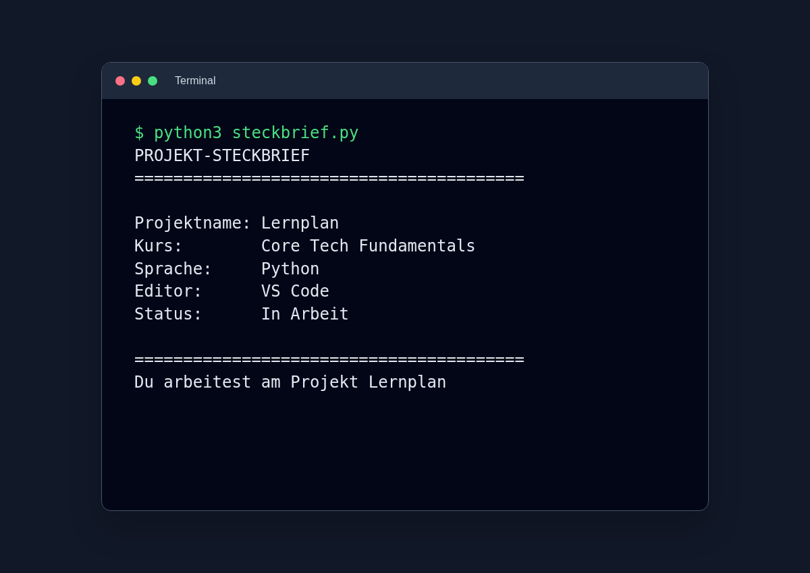

# Variables

## Your goal

Create this project profile. Store the five project details in variables and use them in your output:

## Task

1. Research what a variable is, how to assign a value to it, and how to output that value with `print()`:
   - [W3Schools: Python Variables](https://www.w3schools.com/python/python_variables.asp): Read “Variables” and “Creating Variables”, up to and including the first example with `print(x)` and `print(y)`.
   - If you prefer reading in German: [Python-Kurs: Datentypen und Variablen](https://www.python-kurs.eu/python3_variablen.php#benutzung-von-variablen). Read only the beginning of “Benutzung von Variablen”, up to and including the first `print()` output. You do not need the calculations that follow.
2. Create the file `steckbrief.py`. At the top, define five variables: for the project name, course, programming language, editor and status. Choose suitable names and initially use the text values from the screenshot.
3. Recreate the output with `print()`. Print labels together with the variables. Use the project-name variable in the final sentence too, instead of typing the name again as fixed text. The German labels in the shared screenshot may stay as they are.
4. Run your program with `python3 steckbrief.py`.
5. Change the project name and status only in the assignments at the top. Run the script again. Both occurrences of the project name and the status line should show the new values without changing the `print()` statements.

You can pass a label and a value to `print()`, separated by a comma. Use your variables for this. You do not need to write a summary of your research.
